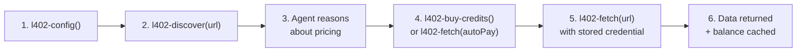

# 402-mcp

**Nostr:** [`npub1mgvlrnf5hm9yf0n5mf9nqmvarhvxkc6remu5ec3vf8r0txqkuk7su0e7q2`](https://njump.me/npub1mgvlrnf5hm9yf0n5mf9nqmvarhvxkc6remu5ec3vf8r0txqkuk7su0e7q2)

[](./LICENSE)
[](https://www.typescriptlang.org/)
[](https://nodejs.org/)

[](https://primal.net/p/npub1mgvlrnf5hm9yf0n5mf9nqmvarhvxkc6remu5ec3vf8r0txqkuk7su0e7q2)
[](https://github.com/sponsors/TheCryptoDonkey)

L402 client MCP that gives AI agents economic agency. Discover, pay for, and consume Lightning and ecash payment-gated APIs within limits you set: no human registration, no API keys, no middlemen.

- **Discover** paid APIs on Nostr, no URLs needed upfront
- **Auto-pay** with Lightning (NWC), Cashu ecash, LNURLcash bearer notes, or human QR fallback
- **Credentials cached and encrypted** at rest (AES-256-GCM)
- **Works with any L402 server**: toll-booth, Aperture, or any future implementation

## Quick start

There is no install step: `npx` fetches 402-mcp when your MCP client first starts it. Running `npx 402-mcp` by hand only starts a stdio server that waits for a client on standard input (stop it with Ctrl+C), so do that to check it launches, not to use it.

**1. Connect it to your MCP client**

Claude Code:

```bash
claude mcp add 402-mcp -- npx 402-mcp
```

Claude Desktop or Cursor, in the MCP configuration file:

```json
{
  "mcpServers": {
    "402-mcp": {
      "command": "npx",
      "args": ["402-mcp"]
    }
  }
}
```

**2. Try it**

Ask Claude: *"Search for paid joke APIs using l402-search"*, no wallet needed, just discovery.

**3. Pay for calls (optional): connect an NWC wallet**

402-mcp reads the Nostr Wallet Connect URI from a private file, never from an environment variable or a command line. Create the file with owner-only permissions first, then paste the URI into it with an editor so it stays out of your shell history:

```bash
mkdir -p ~/.402-mcp
touch ~/.402-mcp/wallet.nwc
chmod 600 ~/.402-mcp/wallet.nwc
# open ~/.402-mcp/wallet.nwc in an editor, paste the URI on one line, save
```

The URI comes from your wallet service and looks like this, with your own values in place of the placeholders:

```
nostr+walletconnect://<wallet-pubkey-hex>?relay=<wss-relay-url>&secret=<secret-hex>
```

It needs a 64-character hex wallet pubkey, one to eight `relay` values, one 64-character hex `secret`, and may carry `lud16`; any other parameter is rejected. The file must be a regular, non-empty file under 8 KiB, and on macOS and Linux it is refused unless group and other have no permissions (`chmod 600`). Create the connection with `pay_invoice` permission and a spending budget (`lookup_invoice` as well lets `l402-reconcile` ask the wallet about unknown outcomes). The wallet must support NIP-44 v2 encryption.

Then register 402-mcp with the absolute path (`$HOME` expands in your shell when you run the command):

```bash
claude mcp remove 402-mcp
claude mcp add 402-mcp -e NWC_URI_FILE="$HOME/.402-mcp/wallet.nwc" -e MAX_AUTO_PAY_SATS=1000 -- npx 402-mcp
```

For Claude Desktop or Cursor, add an `env` block to the same server entry. JSON does not expand `~` or `$HOME`, so write out the absolute path of the file you created:

```json
{
  "mcpServers": {
    "402-mcp": {
      "command": "npx",
      "args": ["402-mcp"],
      "env": {
        "NWC_URI_FILE": "/absolute/path/to/.402-mcp/wallet.nwc",
        "MAX_AUTO_PAY_SATS": "1000"
      }
    }
  }
}
```

A raw `NWC_URI` variable is refused at startup. For Cashu, LNURLcash or no wallet at all, and a first paid call, see the [full quickstart guide](./docs/quickstart.md).

Requires Node.js 22.4 or newer.

## How it works



**Example session:**

```
Agent: "I need routing data from routing.example.com"

1. l402-config()
   -> nwcConfigured: true, maxAutoPaySats: 1000

2. l402-discover("https://routing.example.com/api/route")
   -> 10 sats/request, toll-booth detected, tiers available

3. Agent reasons: "I need ~20 requests. The 500-sat tier
   gives 555 credits. Better value."

4. l402-buy-credits(url, amountSats=500)
   -> Paid 500 sats, received 555 credits

5. l402-fetch("https://routing.example.com/api/route?from=...&to=...")
   -> 200 OK, route data, 545 credits remaining
```

Step 5 needs no `autoPay`: step 4 stored a credential for that server and `l402-fetch` sends it. Without a stored credential, `l402-fetch` pays nothing unless `autoPay: true` is set; it returns the price and a `paymentHash` instead (see [Spending limits](#spending-limits)).

For detailed architecture and payment flow diagrams, see [docs/architecture.md](./docs/architecture.md).

## Configuration

| Variable | Default | Description |
|----------|---------|-------------|
| `NWC_URI_FILE` | - | Path to a private `0600` file containing the NWC bearer URI |
| `CASHU_TOKENS` | - | Path to Cashu token store file. Must be within your home directory |
| `LNURLCASH_NOTES` | - | Path to LNURLcash bearer note store file (LUD-25). Must be within your home directory |
| `MAX_AUTO_PAY_SATS` | 1000 | Most a single automatic payment may cost. Anything dearer is not paid; the challenge goes back to the agent. `0` disables auto-pay |
| `MAX_SPEND_PER_MINUTE_SATS` | 10000 | Automatic spend allowed in any rolling 60 seconds. `0` blocks all auto-pay. At the defaults the daily cap below binds first (see [Spending limits](#spending-limits)) |
| `MAX_SPEND_PER_DAY_SATS` | 5000 | Automatic spend allowed in any rolling 24 hours, kept in `~/.402-mcp/spend-ledger.json` so a restart does not reset it. `0` blocks all auto-pay |
| `CREDENTIAL_STORE` | `~/.402-mcp/credentials.json` | Persistent macaroon/credential storage. Must be within your home directory |
| `TRANSPORT` | `stdio` | Transport mode: `stdio` or `http` |
| `PORT` | 3402 | HTTP server port (when `TRANSPORT=http`) |
| `BIND_ADDRESS` | `127.0.0.1` | HTTP bind address |
| `HTTP_AUTH_TOKEN_FILE` | - | Private `0600` file holding the bearer token HTTP clients must send. Required when `TRANSPORT=http` |
| `HTTP_ALLOWED_HOSTS` | - | Extra `Host` header values the HTTP transport accepts (comma-separated), such as a reverse proxy's name |
| `CORS_ORIGIN` | disabled | CORS origin for the HTTP transport (`*` or one origin). `*` logs a warning: any website could then call the server |
| `TRANSPORT_PREFERENCE` | `onion,hns,https,http` | Preferred transport order for multi-URL services (comma-separated) |
| `TOR_PROXY` | - | SOCKS5 proxy for `.onion` addresses only (e.g. `socks5h://127.0.0.1:9050`) |
| `SOCKS_PROXY` | - | SOCKS5 proxy for every paid-API request (e.g. Tor at `socks5h://127.0.0.1:9050`). Set this or `TOR_PROXY`, not both |
| `HNS_GATEWAY_URL` | `https://query.hdns.io/` | DNS-over-HTTPS resolver used for Handshake names. Any host name that ordinary DNS cannot find is looked up here |
| `HUMAN_PAY_TIMEOUT_S` | 600 | How long the human payer polls the server for settlement, in seconds, when there is no payment page to poll |
| `HUMAN_PAY_POLL_S` | 3 | First polling interval for the human payer, in seconds. It backs off to 30 |
| `FETCH_TIMEOUT_MS` | 30000 | Timeout for each outbound HTTP request |
| `FETCH_MAX_RETRIES` | 2 | Retries for non-mutating requests. Money-mutating POSTs are never retried |
| `FETCH_MAX_RESPONSE_BYTES` | 10485760 | Largest response body accepted (10 MiB) |
| `SSRF_ALLOW_PRIVATE` | false | Allow requests to private and loopback addresses. Local development only |
| `ALLOW_INSECURE_TLS` | false | Acknowledge the risk when `NODE_TLS_REJECT_UNAUTHORIZED=0` is set. Without it (or `SSRF_ALLOW_PRIVATE=true`), 402-mcp refuses to start in that case |

`NWC_URI` and `HTTP_AUTH_TOKEN` are refused at startup: both secrets are read only from their `*_FILE` variables. The spend caps, `MAX_AUTO_PAY_SATS` and `FETCH_MAX_RETRIES` must be non-negative whole numbers; the timeouts, the size limit and the poll interval at least 1; `PORT` 1 to 65535.

### Transport selection and fallback

When a kind 31402 event advertises multiple URLs (one per transport), 402-mcp selects the best one based on your configuration:

1. **Preference first**: URLs are tried in `TRANSPORT_PREFERENCE` order, `onion,hns,https,http` by default. Use `onion`, `hns`, `https` and `http` as the values; there is no value for anything else. A URL counts as `hns` when its TLD is `.hns`. One whose TLD is merely unfamiliar (`.pub`, `.fyi`) is more likely an ICANN name, so it has no value of its own: it counts as a guessed `hns` name and is tried just after whichever of `hns` and `https` comes later in your order, which is just after `https` by default. If you leave `hns` out of `TRANSPORT_PREFERENCE`, such URLs go last.
2. **Capability filter**: `.onion` URLs are skipped unless `TOR_PROXY` or `SOCKS_PROXY` is set, so without a proxy the default order starts at HNS and clearnet.
3. **Availability fallback**: if a transport is unreachable (connection refused, timeout), the next URL is tried.

Services can announce multiple endpoints for the **same service** (same pricing, same macaroon key) on different transports. This is purely for censorship resistance; you do not need to re-authenticate when switching transports. `.onion` endpoints need `TOR_PROXY` or `SOCKS_PROXY`. Handshake endpoints need no configuration, because `HNS_GATEWAY_URL` has a default, except under `SOCKS_PROXY`, which switches Handshake lookups off (see [Tor and SOCKS5](#tor-and-socks5)).

**Credentials across transports.** When `l402-fetch` is given a service's `pubkey` (from `l402-search`), it stores and looks up the credential under that pubkey, so one purchase serves every transport URL passed in `urls`. Without a `pubkey` the credential is keyed by the request's origin. Either way the credential records the origins it was bought through and is sent only to those, whatever pubkey a later request names. A macaroon bought through a Tor hidden service therefore works on the clearnet URL when both were in `urls` at purchase, and is never sent to any other host.

### Tor and SOCKS5

- **`TOR_PROXY`** sends `.onion` requests through the proxy. Everything else connects directly.
- **`SOCKS_PROXY`** sends every request to a paid API through the proxy, including redirects. Host names are resolved by the proxy, never by this machine, so a Tor proxy hides both your IP and the names you look up. The SSRF guard still refuses private IP literals and local names such as `localhost`; it cannot see what a name resolves to on the far side, which Tor exits refuse for private ranges anyway.

Neither setting covers wallet or discovery traffic: NWC relays, Cashu and LNURLcash mints, and the Nostr relays `l402-search` queries still connect directly. Handshake lookups are switched off under `SOCKS_PROXY`, because the DNS-over-HTTPS query would go around the proxy.

SOCKS5 support comes from undici's `Socks5ProxyAgent`, which Node marks experimental; expect one `ExperimentalWarning` on stderr when a proxy is configured.

## Tools

### Core L402 (any server)

| Tool | Description |
|------|-------------|
| `l402-config` | Introspect payment capabilities (wallets, limits, credential count) |
| `l402-discover` | Probe an endpoint to discover pricing without paying |
| `l402-fetch-preview` | Show what an endpoint costs without paying; drives the payment confirmation widget |
| `l402-fetch` | HTTP request that pays a 402 challenge when `autoPay` is set and the price is within the limits |
| `l402-pay` | Pay a challenge returned by `l402-fetch` or `l402-discover`, by its payment hash. Any other invoice needs the human's approval |
| `l402-reconcile` | List or resolve payments whose outcome is unknown; auto-pay to that service is paused until they are resolved |
| `l402-credentials` | List stored credentials and cached balances |
| `l402-balance` | Check cached credit balance for a server |
| `l402-search` | Discover L402 services on Nostr relays (kind 31402 announcements) |
| `l402-store-token` | Store an L402 token obtained from a payment page |

### Widgets (MCP Apps hosts)

| Tool | Description |
|------|-------------|
| `l402-service-directory` | Interactive, searchable directory of services found by `l402-search` |
| `l402-wallet-dashboard` | Interactive view of wallet status, limits and stored credentials |

`l402-fetch-preview` also has a payment confirmation widget.

### toll-booth extensions

| Tool | Description |
|------|-------------|
| `l402-buy-credits` | Browse and purchase volume discount tiers |
| `l402-redeem-cashu` | Redeem Cashu tokens directly (avoids Lightning round-trip) |

### Arguments and results

`*` marks a required argument. Every tool replies with JSON text; failures set the MCP `isError` flag.

| Tool | Arguments | Returns |
|------|-----------|---------|
| `l402-config` | none | `nwcConfigured`, `cashuConfigured`, `cashuBalanceSats`, `maxAutoPaySats`, `maxSpendPerMinuteSats`, `maxSpendPerDaySats`, `spentLast24HoursSats`, `credentialCount`. LNURLcash notes are not reported |
| `l402-discover` | `url`*, `method` (`GET` by default; also `POST`, `PUT`, `PATCH`, `DELETE`, `HEAD`, `OPTIONS`) | `url`, `costSats`, `invoice`, `macaroon`, `paymentHash`; against toll-booth also `server` and `creditTiers`. Reads L402 challenges only, and caches the challenge for `l402-pay` |
| `l402-fetch-preview` | `url`*, `urls` (batch, up to 10), `method`, `headers`, `pubkey` | `status` (`preview`, `free` or `error`) with `endpoint`, `protocol`, `costSats` (`costUsd` for x402), `paymentMethod` (the wallet that would pay), `paymentHash`, `expiresAt`, `message`. An array when `urls` is given |
| `l402-fetch` | `url`*, `urls` (all transport URLs from `l402-search`, up to 10), `pubkey` (from `l402-search`), `method` (as for `l402-discover`), `headers` (object of strings), `body` (string, up to 1,000,000 characters), `autoPay` (default `false`), `maxCostSats` (integer; lowers the cap for this call), `txHash` (`0x` plus 64 hex characters, for a completed x402 payment), `paymentFlow` (see [Storage service announcements](#storage-service-announcements-wildbloom)). There is no payment-method argument | Paid or free: `status`, `headers`, `body` (marked as untrusted content), `creditsRemaining`, `satsPaid`, and `paymentMethod` when an IETF Payment, LNURLcash or xCashu rail paid. Unpaid challenge: `status: 402`, `costSats`, `invoice`, `paymentHash`, `creditsExhausted`, `tiers` when offered, `message`. Human payer: `paymentUrl` or a QR code with the invoice. Failures carry `paymentState` (`failed`, `unknown` or `blocked`) or `error` |
| `l402-pay` | `paymentHash` (of a challenge from `l402-fetch` or `l402-discover`), `method` (`nwc`, `cashu`, `lnurlcash` or `human`), `invoice` and `macaroon` (only for an invoice no challenge produced; the human must approve it) | `paid`, `paymentState` (`paid`, `failed`, `unknown` or `blocked`), `credentialsStored`, `method`, `reason` when it did not succeed |
| `l402-reconcile` | `paymentHash` (64 hex characters; omit to list), `preimage` (64 hex characters), `abandon` (boolean; the human must approve it) | Listing: `unresolved` (each with `paymentHash`, `origins`, `costSats`, `protocol`, `method`, `createdAt`) and `message`. Resolving: `paymentHash`, `resolved`, `state` (`settled`, `failed`, `pending` or `abandoned`), `credentialsStored` when settled, `message` |
| `l402-credentials` | none | `credentials`: for each, `origin`, `origins`, `paymentHash`, `creditBalance`, `storedAt`, `lastUsed`, `server`. Macaroons and preimages are never shown |
| `l402-balance` | `origin`* (a URL such as `https://api.example.com`) | `origin`, `creditsRemaining`, `lastUpdated`, `stale` (true when older than 5 minutes). An error if nothing is stored for that origin |
| `l402-search` | `query`* (up to 200 characters), `topics` (up to 10), `paymentMethod` (the first value of an announcement's `pmi` tag: `l402`, `cashu`, `xcashu`, `lnurlcash`, `x402` or `payment`), `relays` (up to 10 URLs), `maxResults` (1 to 100, default 20), `timeout` (1000 to 30000 ms, default 5000) | An array of services: `name`, `about`, `urls`, `pubkey`, `paymentMethods`, `pricing` (`capability`, `amount`, `unit`), `topics`, `capabilities`, and `storage` for storage services. Announcement text is marked as untrusted content |
| `l402-store-token` | `url`*, `token`* (`macaroon:preimage`) | `stored: true`, `origin`, `paymentHash` when it can be read from the macaroon. An error if the preimage or macaroon is malformed |
| `l402-buy-credits` | `url`* (the toll-booth server), `amountSats` (omit to list tiers), `method` (`nwc`, `cashu` or `human`) | Without `amountSats`: `tiers`. With it: `paid`, `amountSats`, `creditsReceived`, `credentialsStored`, `method`; the human payer returns a QR code and `paymentHash` instead |
| `l402-redeem-cashu` | `url`* (the toll-booth server), `token`* (a Cashu token) | `redeemed: true`, `creditsReceived`, `credentialsStored`, and a `warning` if the credential could not be stored |

## Payment methods

Two separate choices decide how a 402 gets paid: which challenge the server sent, and, for a Lightning invoice, which payer pays it.

**Payer for a Lightning invoice.** An L402 or IETF Payment challenge, `l402-pay` and `l402-buy-credits` pay an invoice with the first available payer in this order:

1. **NWC** (Nostr Wallet Connect): fully autonomous; pays from your connected wallet. Available when `NWC_URI_FILE` is set.
2. **Cashu**: fully autonomous; melts ecash tokens to pay the invoice. Available when the `CASHU_TOKENS` store holds a balance.
3. **LNURLcash**: fully autonomous; melts LUD-25 bearer notes to pay the invoice. Available when the `LNURLCASH_NOTES` store holds a balance.
4. **Human-in-the-loop**: used only when none of the above is available, or when `method: "human"` is passed to `l402-pay` or `l402-buy-credits`. `l402-fetch` does not wait: it returns the toll-booth payment page URL, or a QR code and invoice, at once. You pay from your own wallet, then the agent calls `l402-pay`, which polls the toll-booth payment page for up to 120 seconds (or, with no payment page, the server's `/invoice-status/<hash>` endpoint for `HUMAN_PAY_TIMEOUT_S` seconds). Settlement can only be confirmed where the server reports it, which toll-booth does; other L402 servers do not. Whenever the price is above `MAX_AUTO_PAY_SATS` the human payer does not take over either: the challenge goes back to the agent unpaid.

One payer is chosen per payment and there is no fallback: if it fails, the failure is reported and the next payer is not tried. To use a different payer, pass `method` (`nwc`, `cashu`, `lnurlcash` or `human`) to `l402-pay`, or (`nwc`, `cashu` or `human`) to `l402-buy-credits`. `l402-fetch` has no payment-method argument. You can also configure only the methods you want.

**Challenge the server sent.** `l402-fetch` handles four HTTP 402 challenge variants, plus an experimental x402 format. When a response carries more than one, it checks them in the order below and uses the first it can act on. Every rail still needs `autoPay: true` and a price within the limits.

| Order | Protocol | Challenge header | Payment |
|-------|----------|-----------------|---------|
| 1 | **LNURLcash** (LUD-25) | `X-LNURLcash: lnurlcashreq1…` | Bearer note taken from the note store and handed over directly (requires `LNURLCASH_NOTES`). Not routed through the payer order above |
| 2 | **xCashu** (NUT-18) | `X-Cashu: creqA…` | Ecash token sent directly from the Cashu store (requires `CASHU_TOKENS`). Not routed through the payer order |
| 3 | **x402** (experimental, custom format) | `X-Payment-Required: x402` + JSON body | A custom format, not the x402 specification (whose servers send a base64 `PAYMENT-REQUIRED` header), so real x402 services are not supported. Payment details are shown to the human, who pays from their own wallet |
| 4 | **IETF Payment** (`draft-ryan-httpauth-payment-01`) | `WWW-Authenticate: Payment` | Lightning invoice, paid by the payer order above |
| 5 | **L402** | `WWW-Authenticate: L402` | Lightning invoice, paid by the payer order above |

LNURLcash is checked first because a bearer note is already money in hand, so paying one costs no Lightning hop and no swap at the mint: the note goes straight into the retry header and the server settles it. When the price does not match a note exactly, one is split at the mint and the change stays in the store. If no note covers it, or no note store is configured, the remaining challenges in the same response are tried as usual. The LNURLcash payer in the list above is a different path: it melts notes to pay a Lightning invoice.

`l402-fetch-preview` reports the challenge it finds without paying, and it also names the wallet that would pay (`paymentMethod`). It checks the challenge types in a different order from `l402-fetch` (IETF Payment, L402, LNURLcash, xCashu, x402), so for a server that sends several at once the preview may name a different rail from the one `l402-fetch` uses.

## Spending limits

402-mcp checks every automatic payment against these, and the agent can read them with `l402-config`:

- `MAX_AUTO_PAY_SATS` caps each payment. A dearer challenge is returned to the agent unpaid. `0` disables auto-pay: every priced challenge goes back to the agent.
- `maxCostSats` on `l402-fetch` lowers that cap for one call, so the price shown by `l402-fetch-preview` is binding. It can never raise it.
- `MAX_SPEND_PER_MINUTE_SATS` and `MAX_SPEND_PER_DAY_SATS` cap total automatic spend over rolling windows. The daily window is persisted, so restarting the server does not reset it. `0` in either blocks auto-pay entirely. At the defaults (10,000 per minute, 5,000 per day) the daily cap is the lower one, and spend in any minute also counts towards the day, so the per-minute cap never binds until you lower it or raise the daily cap.
- A payment whose outcome is unknown pauses auto-pay to that service until `l402-reconcile` resolves it, so the same thing is not bought twice.

**The real hard limit is the budget on your NWC connection.** Everything above is enforced in software by this process, on the machine it runs on. Most NWC wallets let you set a spending budget when you create the connection; set one, because that is the limit a bug or a misbehaving agent cannot raise. For Cashu and LNURLcash, the hard limit is what you put in the token or note store.

## Privacy

402-mcp stores credentials locally on your machine only (`~/.402-mcp/credentials.json`, encrypted at rest with AES-256-GCM). The encryption key lives in the OS keychain when one is available (the macOS Keychain through the `security` tool; elsewhere the optional `keytar` module, which often fails to load on current Node). Otherwise it falls back to a file, `~/.402-mcp/encryption.key`, created with `0600` permissions, and 402-mcp warns on startup that the keychain was unavailable; anyone who can read that file can decrypt the store. There are no accounts, no tracking and no analytics, and 402-mcp has no server of its own. It does talk to parties other than the APIs you call:

- **Nostr relays.** `l402-search` subscribes to public relays (by default relay.damus.io, relay.primal.net and nos.lol) for service announcements, sending only the topic filter you give it. The payment-method filter and the query text are matched locally, so relays never see them.
- **A Handshake resolver.** When ordinary DNS cannot find a host name, it is looked up at `HNS_GATEWAY_URL` (`https://query.hdns.io/` by default), which therefore sees that name. This is off under `SOCKS_PROXY`.
- **Your wallet's services.** NWC relays, Cashu mints and LNURLcash mints see the payments you make through them.

Payments use Lightning or ecash, which are pseudonymous rather than anonymous.

## Using the modules in code

The package exposes nine subpath imports. Each maps to `build/<path>.js` with its declaration file beside it, so TypeScript finds the types without a `types` field:

| Import | Contents |
|--------|----------|
| `402-mcp/tools/*` | Tool handlers and `register*Tool` functions, such as `402-mcp/tools/fetch` |
| `402-mcp/l402/*` | `parse`, `detect`, `bolt11`, `challenge-cache` |
| `402-mcp/x402/*`, `402-mcp/xcashu/*`, `402-mcp/xlnurlcash/*`, `402-mcp/ietf-payment/*` | Challenge parsers and payment helpers for each rail |
| `402-mcp/store/*` | Credential, Cashu token, LNURLcash note and pending-payment stores |
| `402-mcp/fetch/*` | Resilient fetch, SSRF guard, transport selection, SOCKS and Handshake resolution |
| `402-mcp/spend-tracker` | `SpendTracker` |

These are the server's own modules, exposed as they are; read `src/` for their signatures. Do not import the package root (`402-mcp`) from library code: `main` and the `.` export both point at the server entry, `build/index.js`, which loads configuration from the environment and connects a transport as soon as it is imported.

```ts
import { SpendTracker } from '402-mcp/spend-tracker'
import { parseL402Challenge } from '402-mcp/l402/parse'

const tracker = new SpendTracker()
console.log(tracker.tryRecord(50, 10_000)) // true: 50 sats fits under a 10,000 sat per-minute cap

const challenge = parseL402Challenge('L402 macaroon="AgEEbG5kcg==", invoice="lnbc10n1pexample"')
console.log(challenge) // { macaroon: 'AgEEbG5kcg==', invoice: 'lnbc10n1pexample' }
```

## Storage service announcements (Wildbloom)

`l402-search` also returns storage services announced with the `forgesworn-storage-service-v1` profile (kind 31402, validated by `402-announce/storage` 2.3.0). Wildbloom is one such service: it offers paid storage, and a free tier called free shelter, which keeps copies pushed by authorised mirrors on a best-effort basis, may evict them, and does not take direct uploads from unknown users.

These results are descriptive only. A paid storage result carries `storage.paymentFlow: "wildbloom-checkout-v1"` and `autoPaySupported: false`, and 402-mcp cannot buy it. Do not hand that flow to `l402-fetch` or `l402-pay`: both refuse it, and `l402-fetch` also refuses any `/checkout/v1` path, before any network, credential or wallet access. To buy, read the operator's current terms (its `/services/v1` listing) and use Wildbloom's own checkout, which asks for a private quote signed with NIP-98 (Nostr HTTP authentication) and an explicit payment from you. Mirroring to free shelter is not something these tools do either. The terms in an announcement are the operator's own claims, not a recommendation or proof of uptime, and a valid signature shows only who published it; it never authorises a purchase.

How results are chosen: search contacts only the relays you name (or the defaults), never a storage node or a wallet. The newest valid signed announcement for each service (same publisher and `d` tag; on equal timestamps the lowest event ID) is selected before expiry, withdrawal and query filters apply. So that a relay replaying an older copy cannot revive a withdrawn or expired offer, the newest record seen for each service is kept in memory as a watermark: up to 2,000 per search handler, kept across calls until the server restarts, and a search that would exceed that fails with an error rather than dropping any. A fresh server has no watermarks, so it cannot know about a record a relay leaves out. Full or paused listings that are still current remain in the results; expired and withdrawn ones stay as watermarks but are not returned. Discovery stores nothing on disk and opens no browser.

## Ecosystem

Browse live L402 services at [402.pub](https://402.pub), the decentralised marketplace for payment-gated APIs.

| Project | Role |
|---------|------|
| [toll-booth](https://github.com/forgesworn/toll-booth) | Payment-backend agnostic HTTP 402 middleware |
| [satgate](https://github.com/TheCryptoDonkey/satgate) | Pay-per-token AI inference proxy (built on toll-booth) |
| **[402-mcp](https://github.com/forgesworn/402-mcp)** | **MCP client: AI agents discover, pay for and consume L402 APIs** |
| [402-announce](https://github.com/forgesworn/402-announce) | Publish L402 services on Nostr for decentralised discovery |

402-mcp is the **wallet-provider agnostic** alternative to Lightning Labs' [lightning-agent-tools](https://github.com/lightninglabs/lightning-agent-tools): no Lightning node required, multiple wallets, encrypted credentials.

<details>
<summary>Full comparison</summary>

| | 402-mcp | Lightning Labs agent tools |
|---|---|---|
| **Payer methods** | NWC + Cashu + LNURLcash + human fallback | Lightning only |
| **Node required?** | No, connects to any NWC wallet | Yes, runs LND |
| **Server compatibility** | Any L402 server | Aperture-focused |
| **Spend safety** | Per-payment cap, per-call max cost, rolling 60s and persisted 24h windows | Per-call max-cost (`--max-cost`) |
| **Credential storage** | Encrypted at rest (AES-256-GCM) | File permissions |
| **Privacy** | No PII, SSRF protection, error sanitisation | Standard |

The Lightning Labs spend-safety cell comes from the lnget documentation in [lightning-agent-tools](https://github.com/lightninglabs/lightning-agent-tools): `--max-cost` sets the most lnget will auto-pay for a single request ([docs/l402-and-lnget.md](https://github.com/lightninglabs/lightning-agent-tools/blob/main/docs/l402-and-lnget.md)), and that page documents no budget across requests. The other cells in that column are not sourced here.

Use Lightning Labs' tools if you want agents that **run their own Lightning node**. Use 402-mcp if you want agents that **pay from any wallet without infrastructure**.

</details>

See [CONTRIBUTING.md](./CONTRIBUTING.md) for development setup and guidelines.

---

Built by [@forgesworn](https://github.com/forgesworn).

- Lightning tips: `profusemeat89@walletofsatoshi.com`
- Nostr: `npub1mgvlrnf5hm9yf0n5mf9nqmvarhvxkc6remu5ec3vf8r0txqkuk7su0e7q2`

---

## Part of the ForgeSworn Toolkit

[ForgeSworn](https://forgesworn.dev) builds open-source cryptographic identity, payments, and coordination tools for Nostr.

| Library | What it does |
|---------|-------------|
| [nsec-tree](https://github.com/forgesworn/nsec-tree) | Deterministic sub-identity derivation |
| [ring-sig](https://github.com/forgesworn/ring-sig) | SAG/LSAG ring signatures on secp256k1 |
| [range-proof](https://github.com/forgesworn/range-proof) | Pedersen commitment range proofs |
| [canary-kit](https://github.com/forgesworn/canary-kit) | Coercion-resistant spoken verification |
| [spoken-token](https://github.com/forgesworn/spoken-token) | Human-speakable verification tokens |
| [toll-booth](https://github.com/forgesworn/toll-booth) | L402 payment middleware |
| [geohash-kit](https://github.com/forgesworn/geohash-kit) | Geohash toolkit with polygon coverage |
| [nostr-attestations](https://github.com/forgesworn/nostr-attestations) | NIP-VA verifiable attestations |
| [dominion](https://github.com/forgesworn/dominion) | Epoch-based encrypted access control |
| [nostr-veil](https://github.com/forgesworn/nostr-veil) | Privacy-preserving Web of Trust |

## Licence

[MIT](LICENSE)
