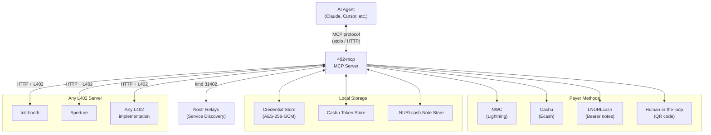
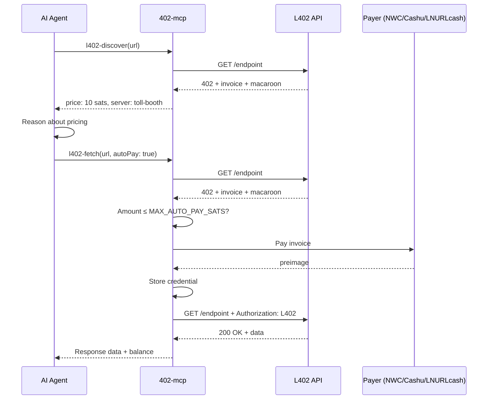
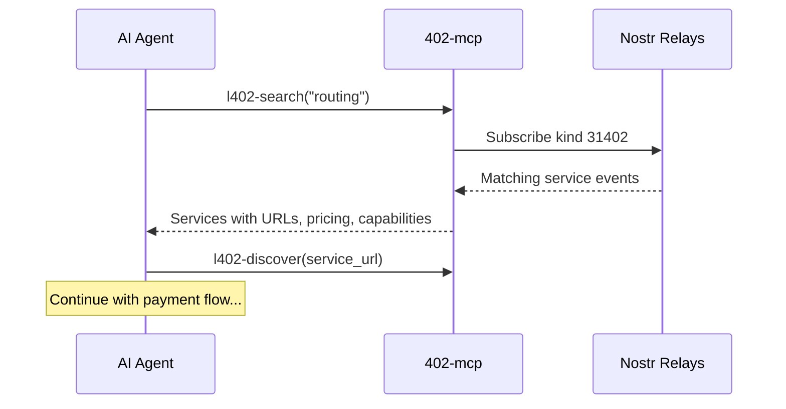
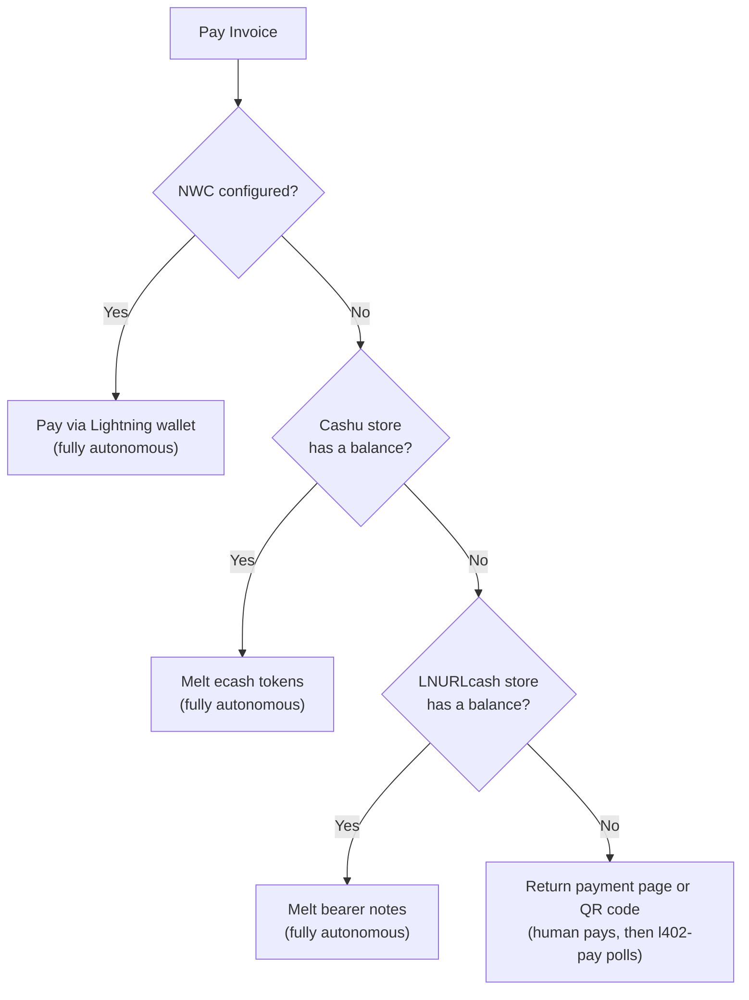

# Architecture

Technical reference diagrams for 402-mcp. For a quick overview, see the [README](../README.md).

## System architecture

How 402-mcp connects AI agents to paid APIs using several payer methods.

## Payment flow

The full lifecycle: discover pricing, pay the invoice, store the credential, fetch the data.

## Service discovery

Agents discover paid APIs without knowing URLs upfront. `l402-search` queries Nostr relays for kind 31402 service announcements, the decentralised registry for L402 services.

## Payment method selection

For a Lightning invoice, 402-mcp picks the first available payer in this order. Only that one is tried: if its payment fails, the failure is reported and the next payer is not used. `l402-pay` and `l402-buy-credits` can choose a payer with their `method` argument; `l402-fetch` cannot.

## Challenge selection

The payer order above applies to Lightning invoices only. `l402-fetch` first looks at which challenge the server sent, and checks them in this order: `X-LNURLcash`, `X-Cashu`, `X-Payment-Required: x402`, `WWW-Authenticate: Payment`, then `WWW-Authenticate: L402`. An LNURLcash note or an xCashu token is paid straight from its own store and does not go through the payer order. If no note covers an LNURLcash price, the later challenges in the same response are tried. x402 payment details are shown to the human and never paid autonomously.
